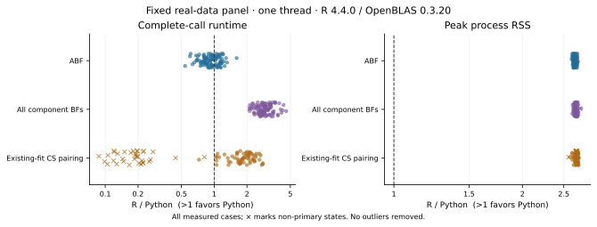

# pycoloc

Bayesian colocalisation in Python.

Compare two traits using approximate Bayes factors or SuSiE-derived component
Bayes factors, with numerical validation against R coloc. pycoloc implements
established colocalisation methods using NumPy/SciPy and an optional Numba kernel.

- **Numerical agreement:** ABF and identical-BF/fit comparisons cover all 100 real regions.
- **Measured BF pairing:** 2.91× paired geometric-mean speedup on 99 mutually converged regions.
- **Lower peak process RSS:** ABF median 97.7 MiB versus 259 MiB for R, with lower peaks in all 100 cases.

## Numerical agreement

Fresh pycoloc 0.2.2 calculations use the same inputs as frozen coloc 6.0.3 outputs
on 100 real regions. The largest absolute H0–H4 differences are 1.07×10⁻¹⁴ for
ABF, 1.02×10⁻¹¹ for full component-BF pairing and 1.60×10⁻¹⁴ for pairing the same
official SuSiE fits.

With prusie 0.3.1 fitting each trait first, 99 regions have mutually converged
fits; 65 yield posterior pairs and 34 have no CS. Across the 65 numeric
comparisons, regional maximum H0–H4 differences have median 1.77×10⁻¹¹,
95th percentile 4.00×10⁻⁹ and maximum 9.70×10⁻⁹. The largest conditional SNP
difference is 7.47×10⁻⁸. CS membership agrees; region25's nonconverged fit is
reported separately. See [R agreement](docs/r_agreement.md) for distributions,
toy-example results and the [intentional scientific corrections](docs/upstream_differences.md).

## Performance

Measured pycoloc **0.2.2rc3** complete calls with one numerical thread against coloc 6.0.3 in R 4.4.0 / OpenBLAS 0.3.20. The fixed panel contains 100 real regions, 103–4162 SNPs each. Tables include all ABF cases and converged BF/CS pairings with available output.

| Task | Comparable cases | Median time, R → Python (ms) | Paired speedup¹ | Faster / tied / slower |
| --- | ---: | ---: | ---: | ---: |
| ABF | 100/100 | 4.33 → 4.29 | 0.928× | 35 / 0 / 65 |
| All component BFs | 99/100 | 40.3 → 13.5 | 2.91× | 99 / 0 / 0 |
| Existing-fit CS pairing | 65/100 | 8.49 → 4.2 | 1.81× | 64 / 0 / 1 |

¹ Geometric mean of per-case speedups; seven retained repetitions after warmup. Speedup pairs each case; the displayed time columns are separate across-case medians.

ABF was slower in 65/100 cases. Across all 100 CS-pairing calls, including 34 no-CS regions and one nonconverged region, there were 64 faster and 36 slower calls; geometric-mean speedup was 0.812×.

| Task | Median peak process RSS, R → Python (MiB) | Lower / tied / higher in Python |
| --- | ---: | ---: |
| ABF | 259 → 97.7 | 100 / 0 / 0 |
| All component BFs | 260 → 97.5 | 99 / 0 / 0 |
| Existing-fit CS pairing | 260 → 96.9 | 65 / 0 / 0 |



Peak process RSS includes imports, inputs and full results, measured in a separate fresh process. [Methods, all cases, repeat variability and public-fixture results](docs/performance.md) give the comparison scope.

## Installation

Install pycoloc **0.2.2** with Python ≥3.10 from the GitHub Release wheel:

```sh
python -m pip install https://github.com/LucaJiang/pycoloc/releases/download/v0.2.2/pycoloc-0.2.2-py3-none-any.whl
```

Or install the tagged source:

```sh
python -m pip install "git+https://github.com/LucaJiang/pycoloc.git@v0.2.2"
```

pycoloc is not published on PyPI. The PyPI project named `pycoloc` is unrelated:
`pip install pycoloc` installs that other package. This GitHub repository is private;
access to its source and Release assets requires authorization. For the wheel path,
download the asset while signed in and install the local file if pip cannot authenticate.

Keep a checkout for the bundled offline example data.

## Quick start

Run from the checkout. The bundled data are the complete **synthetic 500-SNP
coloc toy example**, with stored quantitative-trait sample sizes and sdY.

```python
import json
from pathlib import Path

import numpy as np
from pycoloc import coloc_abf

data = Path("examples/data")
metadata = json.loads((data / "metadata.json").read_text())
with np.load(data / "inputs.npz", allow_pickle=False) as arrays:
    datasets = [
        dict(
            snp=metadata[key]["snp"],
            type=metadata[key]["type"],
            N=metadata[key]["N"],
            sdY=metadata[key]["sdY"],
            beta=arrays[key + "_beta"],
            varbeta=arrays[key + "_varbeta"],
        )
        for key in ("D1", "D2")
    ]

result = coloc_abf(*datasets)
print(result.summary[[f"PP.H{i}.abf" for i in range(5)]])
print(result.results[["snp", "SNP.PP.H4"]].nlargest(5, "SNP.PP.H4"))
```

`PP.H4.abf` is support for a shared causal variant. H0 means neither trait is
associated; H1/H2 mean only one is associated; H3 means different causal variants.
`SNP.PP.H4` ranks variants conditional on H4, so interpret it alongside H4 support;
it is not a fine-mapping PIP. This example returns H4 ≈0.99917 and ranks s105 first.

## Methods and scope

The APIs support variant prior weights and existing SuSiE fits; the package also provides locus plots. Fit each trait once and reuse it for subsequent pairings.

| Input | Function | Interpretation |
| --- | --- | --- |
| Beta/SE² or P values with required metadata | `coloc_abf` | At most one causal variant per trait; no LD required |
| Full component log-BF rows | `coloc_bf_bf` | Posterior for each component pair |
| Existing SuSiE fits | `coloc_susie` | Pairs original credible-set components; keeps every SNP column |

Each pair-specific H4 in a multiple-signal analysis describes that comparison;
those rows do not define a region-wide posterior. Fine-mapping with
[prusie](https://github.com/LucaJiang/prusie) is optional. ABF and existing-fit
pairing run directly without a fine-mapping dependency. For SuSiE, signed LD r,
SNP/effect-allele alignment and convergence matter; see [inputs](docs/inputs.md)
and the [fit-reuse example](docs/example.md#fit-once-and-reuse-the-result).

## Documentation and reproducibility

Read the [documentation site](https://lucajiang.github.io/pycoloc/),
[API](docs/api.md), [results](docs/result_schema.md) and [locus plots](docs/locus_plot.md).
Run the offline frozen-reference check after installation:

```sh
python examples/check_example.py --output-dir example-output
```

[Comparison scripts](benchmarks/README.md), input provenance and per-field checks
are linked from the [agreement report](docs/r_agreement.md).

## Citation and license

Maintained by Wenxin Jiang. Cite the original [coloc methods](docs/methods.md)
and identify the pycoloc version used; package citation metadata is in [CITATION.cff](CITATION.cff).
GPL-3.0-or-later; see [LICENSE](LICENSE) and [third-party notices](THIRD_PARTY_NOTICES.md)
for the retained upstream code and example-data terms.
