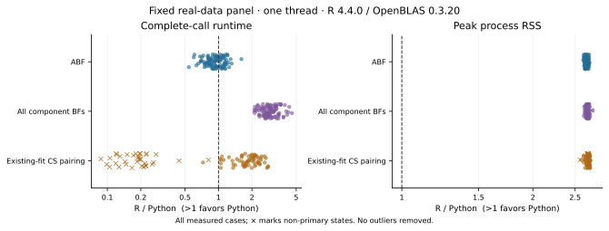

# pycoloc

Bayesian colocalisation in Python.

Compare two traits using approximate Bayes factors or SuSiE-derived component
Bayes factors, with numerical validation against R coloc. pycoloc implements
established colocalisation methods using NumPy/SciPy and an optional Numba kernel.

- **Numerical agreement:** supported ABF and identical-BF/fit comparisons pass in all 100 real regions.
- **Measured BF pairing:** 2.91× paired geometric-mean speedup on 99 mutually converged regions.
- **Lower peak process RSS:** ABF median 97.7 MiB versus 259 MiB for R, with lower peaks in all 100 cases.

## Numerical agreement

New calls compare pycoloc 0.2.2rc3 with coloc 6.0.3 on all 100 fixed real regions, using matched inputs.

| Comparison | Passing / total regions or pairs | Max absolute H0–H4 error | Max absolute conditional SNP error |
| --- | ---: | ---: | ---: |
| ABF | 100/100 | 1.07e-14 | 1.24e-14 |
| Same component BFs | 100/100 | 1.02e-11 | 4.55e-15 |
| Same official SuSiE fits | 100/100 | 1.6e-14 | 1.44e-15 |

No-CS states are checked explicitly. The complete 500-SNP teaching pairs also pass these comparisons. Native fitting followed by colocalisation has separate, stricter-field discrepancies in 48/100 real regions; see [R agreement](r_agreement.md) and [intentional mathematical corrections](upstream_differences.md).

## Performance

Complete calls with one numerical thread against coloc 6.0.3 in R 4.4.0 / OpenBLAS 0.3.20. The fixed panel contains 100 real regions, 103–4162 SNPs each. Tables include all ABF cases and converged BF/CS pairings with available output.

| Task | Comparable cases | Median time, R → Python (ms) | Paired speedup¹ | Faster / tied / slower |
| --- | ---: | ---: | ---: | ---: |
| ABF | 100/100 | 4.33 → 4.29 | 0.928× | 35 / 0 / 65 |
| All component BFs | 99/100 | 40.3 → 13.5 | 2.91× | 99 / 0 / 0 |
| Existing-fit CS pairing | 65/100 | 8.49 → 4.2 | 1.81× | 64 / 0 / 1 |

¹ Geometric mean of per-case speedups; seven retained repetitions after warmup. Speedup pairs each case; the displayed time columns are separate across-case medians.

ABF was slower in 65/100 cases. Across all 100 CS-pairing calls, including 34 no-CS regions and one nonconverged region, there were 64 faster and 36 slower calls; geometric-mean speedup was 0.812×.

| Task | Median peak process RSS, R → Python (MiB) | Lower / tied / higher in Python |
| --- | ---: | ---: |
| ABF | 259 → 97.7 | 100 / 0 / 0 |
| All component BFs | 260 → 97.5 | 99 / 0 / 0 |
| Existing-fit CS pairing | 260 → 96.9 | 65 / 0 / 0 |



Peak process RSS includes imports, inputs and full results, measured in a separate fresh process. [Methods, all cases, repeat variability and public-fixture results](performance.md) give the comparison scope.

## Installation

Python ≥3.10. A local release wheel can be installed directly, with dependencies:

```sh
python -m pip install ./pycoloc-0.2.2rc3-py3-none-any.whl
```

The wheel is prepared locally; public downloads are not yet available. Source is available now:

```sh
git clone https://github.com/LucaJiang/pycoloc.git
cd pycoloc
python -m venv .venv
. .venv/bin/activate
python -m pip install .
```

Keep the checkout for the bundled data. See [installation](install.md) for
optional Numba and annotation support.

## Quick start

Run from the checkout. The bundled data are the complete **synthetic 500-SNP
coloc teaching fixture**, with stored quantitative-trait sample sizes and sdY.

```python
import json
from pathlib import Path

import numpy as np
from pycoloc import coloc_abf

data = Path("examples/data")
metadata = json.loads((data / "metadata.json").read_text())
with np.load(data / "inputs.npz", allow_pickle=False) as arrays:
    datasets = [
        dict(snp=metadata[key]["snp"], type=metadata[key]["type"],
             N=metadata[key]["N"], sdY=metadata[key]["sdY"],
             beta=arrays[key + "_beta"], varbeta=arrays[key + "_varbeta"])
        for key in ("D1", "D2")
    ]

result = coloc_abf(*datasets)
print(result.summary[[f"PP.H{i}.abf" for i in range(5)]])
print(result.results[["snp", "SNP.PP.H4"]].nlargest(5, "SNP.PP.H4"))
```

`PP.H4.abf` is support for a shared causal variant. H0 means neither trait is
associated; H1/H2 mean only one is associated; H3 means different causal variants.
`SNP.PP.H4` ranks variants conditional on H4, so interpret it alongside H4 support;
it is not a fine-mapping PIP. This example returns H4 ≈0.99917 and ranks s105 first.

## Methods and scope

The APIs support variant prior weights and existing SuSiE fits; the package also provides locus plots. Fit each trait once and reuse it for subsequent pairings.

| Input | Function | Interpretation |
| --- | --- | --- |
| Beta/SE² or P values with required metadata | `coloc_abf` | At most one causal variant per trait; no LD required |
| Full component log-BF rows | `coloc_bf_bf` | Posterior for each component pair |
| Existing SuSiE fits | `coloc_susie` | Pairs original credible-set components; keeps every SNP column |

Each pair-specific H4 in a multiple-signal analysis describes that comparison;
those rows do not define a region-wide posterior. Fine-mapping with
[prusie](https://github.com/LucaJiang/prusie) is optional. ABF and existing-fit
pairing run directly without a fine-mapping dependency. For SuSiE, signed LD r,
SNP/effect-allele alignment and convergence matter; see [inputs](inputs.md)
and the [fit-reuse example](example.md#fit-once-and-reuse-the-result).

## Documentation and reproducibility

Read the [documentation site](https://lucajiang.github.io/pycoloc/),
[API](api.md), [results](result_schema.md) and [locus plots](locus_plot.md).
Run the offline frozen-reference check after installation:

```sh
python examples/check_example.py --output-dir example-output
```

[Comparison scripts](https://github.com/LucaJiang/pycoloc/tree/main/benchmarks/README.md), input provenance and per-field checks
are linked from the [agreement report](r_agreement.md).

## Citation and license

Maintained by Wenxin Jiang. Cite the original [coloc methods](methods.md)
and identify the pycoloc version used; package citation metadata is in [CITATION.cff](https://github.com/LucaJiang/pycoloc/blob/main/CITATION.cff).
GPL-3.0-or-later; see [LICENSE](https://github.com/LucaJiang/pycoloc/blob/main/LICENSE) and [third-party notices](https://github.com/LucaJiang/pycoloc/blob/main/THIRD_PARTY_NOTICES)
for the retained upstream code and teaching-data terms.
