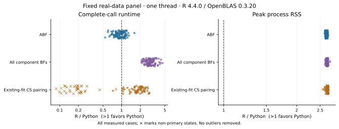

# Runtime and peak memory

pycoloc was timed against coloc 6.0.3 on 100 real regions and on coloc's
500-variant toy example. The measurements used pycoloc 0.2.2rc3 (with prusie
0.2.3rc4 for the fits), R 4.4.0 with OpenBLAS 0.3.20 and susieR 0.16.6, and one
numerical thread in both languages. The inference code is unchanged in 0.2.2.

The regions are association windows from one GWAS and one eQTL study, chosen
before these measurements, with 103–4162 variants each. They are not a random
sample of loci.

## Real regions

| Task | Regions | Median time, R → pycoloc (ms) | Speedup¹ | Faster / slower |
| --- | ---: | ---: | ---: | ---: |
| ABF | 100 | 4.33 → 4.29 | 0.928× | 35 / 65 |
| Pairing all component Bayes factors | 99 | 40.3 → 13.5 | 2.91× | 99 / 0 |
| Pairing credible sets of existing fits | 65 | 8.49 → 4.20 | 1.81× | 64 / 1 |

¹ Geometric mean of the per-region ratio of median R time to median pycoloc time.
The two time columns are medians across regions, so their ratio need not equal
the speedup. No region was tied.

| Task | Median peak RSS, R → pycoloc (MiB) | Regions with lower RSS |
| --- | ---: | ---: |
| ABF | 259 → 97.7 | 100 / 100 |
| Pairing all component Bayes factors | 260 → 97.5 | 99 / 99 |
| Pairing credible sets of existing fits | 260 → 96.9 | 65 / 65 |

The tables use regions where both calls succeeded and both fits converged; fitting
itself is not timed. ABF takes a few milliseconds in either language, and pycoloc
is slightly slower in 65 regions (slowest ratio 0.54×, region49). Credible-set
pairing is slower only in region45 (0.73×). In the other 35 regions (34 without a
credible set, one nonconverged) both return almost immediately, R in a median
0.2 ms and pycoloc in 1.1 ms; including them gives a geometric-mean speedup of 0.81×.

Per-region speedups vary more than the summary suggests:

| Task | Median speedup [Q1, Q3] | Range | Median relative repeat IQR, R / pycoloc |
| --- | --- | --- | ---: |
| ABF | 0.939 [0.814, 1.07] | 0.541–1.61 | 0.152 / 0.058 |
| Pairing all component Bayes factors | 2.89 [2.59, 3.23] | 2.11–4.58 | 0.120 / 0.012 |
| Pairing credible sets of existing fits | 1.89 [1.64, 2.16] | 0.726–2.80 | 0.117 / 0.047 |

Relative repeat IQR is (Q3 − Q1) / median across the seven repeats of one region.

## Toy example

| Task | Pairs | Median time, R → pycoloc (ms) | Speedup¹ | Median peak RSS, R → pycoloc (MiB) |
| --- | ---: | ---: | ---: | ---: |
| ABF | 2 | 4.17 → 4.84 | 0.855× | 259 → 99.2 |
| Pairing all component Bayes factors | 2 | 180 → 48.2 | 3.73× | 263 → 99.0 |
| Pairing credible sets of existing fits | 2 | 8.59 → 4.98 | 1.73× | 260 → 97.0 |

The pairs are D1/D2 and D3/D4.

## How the measurements were made

Each call goes through the public API (`coloc_abf`, `coloc_bf_bf`, `coloc_susie`
and their R counterparts). Inputs are loaded before the clock starts; input
checks, preprocessing and building the result tables are timed. Each backend gets
one warmup and seven timed repeats; very short calls are batched in the same way
for both. The order of R and Python alternates between regions, and all calls ran
one after another.

Peak RSS is the operating-system high-water mark of a fresh process that makes one
call. It includes the interpreter, imported libraries, the loaded inputs and the
returned result, so it mostly reflects the size of the Python and R runtimes rather
than the colocalisation algorithm. The default NumPy path was measured, not Numba.

The [comparison scripts](https://github.com/LucaJiang/pycoloc/tree/main/benchmarks)
reproduce a single call. The complete records are available as a
[per-region table](assets/r_comparison_cases.tsv) ([JSON](assets/r_comparison_cases.json)),
[all repeats](assets/r_comparison_repeats.json), a [summary](assets/r_comparison_summary.json)
and the [protocol](assets/r_comparison_protocol.json). Genotypes, association
files and variant IDs from the real regions are not redistributed.

## Complexity

The H3 sum uses O(m) work for m shared variants and never forms an m × m matrix.
A full call also validates, aligns and sorts variants and builds pandas tables.
ABF needs no LD. Fine-mapping upstream needs a dense m × m LD matrix (about 8m²
bytes in float64). Thinning LD for a [locus plot](locus_plot.md) affects only the
figure.
