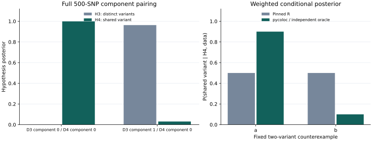

# Executed agreement with official R

**The recorded pycoloc 0.2.2rc2 execution passed the stated unweighted ABF and identical-fit pairing checks on the complete 500-SNP upstream teaching fixture.** Corrected weighted fields deliberately differ from pinned R and instead pass independent mathematical checks. This report separates those outcomes.

## Reproduce the check

Follow [installation](install.md), then run from the checkout:

```sh
python examples/check_example.py --output-dir example-output
```

The command checks your installed version against the same frozen expectations and writes numeric/structural results. Standalone execution needs neither R nor prusie. The checkout includes every input and reference used here.

## Public fixture, not new biological evidence

These are existing **synthetic teaching datasets**, not a newly simulated study or a human dataset. Actual stored arrays—not stale help text—confirm 500 unique variables in D1, D2, D3 and D4. All are retained in original order. No padding, duplication, SNP selection based on agreement, or random generation was used.

D1/D2 share the stored causal label s105. D3 has s105 and s89; D4 has s105. N=1000 and sdY come from the stored object. Signed LD r retains the upstream synthetic variable convention and explicit axis order. Positions 1–500 are synthetic indices; biological build, ancestry and alleles are unavailable. Redistribution retains the upstream GPL declaration and attribution in the bundle. The [example guide](example.md) describes the files and regeneration recipe.

## 1. Direct quantitative ABF agreement

All calls use the beta/varbeta route and stored sdY, with default quantitative prior SD 0.15 × sdY. R and Python receive the same complete dataset pairs. Two calls pass literally no prior arguments (public defaults p1=p2=1e-4, p12=1e-5), and two explicitly set p12=5e-6 for consistency with the BF-pairing examples. No fine-mapping or LD calculation occurs in this layer. The literal-default R outputs, checked actual defaults and regeneration recipe are a separate immutable supplement in examples/data/default_abf/.

| Full 500-SNP pair | Max absolute H0–H4 error | Max absolute logBF error, either trait | Max absolute SNP.PP.H4 error | Result |
| --- | ---: | ---: | ---: | --- |
| D1 / D2, literal defaults | 1.110e-16 | 6.750e-14 | 1.110e-16 | PASS |
| D3 / D4, literal defaults | 2.220e-16 | 7.105e-14 | 4.441e-16 | PASS |
| D1 / D2, explicit p12=5e-6 | 2.646e-17 | 6.750e-14 | 1.110e-16 | PASS |
| D3 / D4, explicit p12=5e-6 | 3.331e-16 | 7.105e-14 | 4.441e-16 | PASS |

Hypothesis probabilities use the existing atol=1e-10, rtol=0 criterion. LogBF and conditional SNP posterior comparisons retain atol=1e-10, rtol=1e-10. SNP identities/order and counts compare exactly; hypothesis and conditional probabilities are finite, in [0,1] and normalized. The thresholds follow the inherited comparison scripts; no threshold was relaxed after execution.

D3 contains two upstream signals. Its ABF call is included to compare identical software inputs; the single-causal-variant ABF model does not become a multi-signal model because that call agrees. Use the component-pair layer for the multi-signal interpretation.

## 2. Colocalisation on identical official-R fits

Official susieR fits are exported to numeric arrays and JSON. Both coloc implementations consume those same fits: this isolates BF pairing from numerical differences in fitting. pycoloc selects the original credible-set component IDs and keeps the entire logBF row across all 500 SNPs, not only CS members. `coloc_bf_bf` is also called separately on those complete selected rows and matches `coloc_susie` exactly in this execution. Those two public paths share the production pairing implementation, so this is API consistency evidence; independence comes from the official-R comparisons.

| Pair | Original components (Python, zero-based) | Max absolute H0–H4 error | Max absolute SNP.PP.H4 error | Result |
| --- | --- | ---: | ---: | --- |
| D1 / D2 | 0 / 0 | 4.441e-16 | 9.923e-16 | PASS |
| D3 / D4, shared signal | 0 / 0 | 2.168e-19 | 1.110e-16 | PASS |
| D3 / D4, additional versus shared signal | 1 / 0 | 1.665e-15 | 1.033e-14 | PASS |

R IDs are the original Python component IDs plus one. IDs are matched explicitly; return order is not treated as scientific identity. Lead SNPs and SNP count agree exactly. The D3/D4 official H4 values are approximately 0.999161 for the shared pair and 0.0304694 for the additional-versus-shared pair. The latter favors H3, approximately 0.963106. No single region-wide H4 is synthesized from these rows.

The frozen official fits converge in 2 iterations for D1, D2 and D4 and 8 for D3, returning 1, 1, 1 and 2 CS respectively. Actual returned coverage is stored separately from requested 0.95; it is not replaced with 0.95 or zero.

<figure>

<figcaption>Saved executed outputs. Left: colocalisation on identical official-R fits, using all 500 SNPs. Right: the fixed two-variant weighted counterexample. Synthetic examples are software checks, not new biological evidence.</figcaption>
</figure>

## 3. Edges and corrected weighted behavior

| Case | Actual behavior | Check |
| --- | --- | --- |
| D3 strict purity / D4 | R returns unavailable; pycoloc returns `status='no_cs'`, no hypothesis rows | PASS; no fabricated H4=0 |
| D3 one iteration / D4 | D3 really did not converge; warning and `[False, True]` metadata remain visible | PASS as a labelled diagnostic, not an accepted fit |
| Two equal BFs, weights [9,1] and [1,1] | Corrected shared-SNP probabilities [0.9,0.1] | Max oracle error 1.110e-16 |
| Partial-zero weights [1,0] and [1,1] | Corrected shared-SNP probabilities [1,0] | Exact oracle match; R BF wrapper rejects this input |
| Disjoint weights [1,0] and [0,1] | H4=0 with undefined conditional SNP posterior; H3 stays positive | Correct state and Decimal hypotheses |
| Fixed index weights on all 500 D1/D2 SNPs | Shared priors stay bound to SNP IDs through sorting | H0–H4 oracle error 4.441e-16; SNP error 2.331e-15 |

The independent small oracle enumerates all H0–H4 configurations in Decimal arithmetic. With unit BFs, q1=[0.00018,0.00002], q2=[0.0001,0.0001], and q12=q1×q2×p12/(p1×p2)=[0.000009,0.000001]. Conditional shared-SNP probabilities are q12/sum(q12)=[0.9,0.1]. This expectation does not call either package.

Pinned R returns [0.5,0.5] in its main SNP posterior despite weighted H4 evidence: **the actual maximum discrepancy is 0.4**, while H0–H4 agree to 4.441e-16 in that small case. On the fixed 500-SNP index-weight example, the original-R discrepancies are 0.00286208 for H0–H4 and 0.0709902 for SNP.PP.H4. The default per-SNP ABFs still agree. The known R sort/weight association and omission of weights from its main SNP posterior explain why this is a corrected-mathematics comparison, not an unqualified parity claim.

The weights are predeclared software checks, `1 + (one_based_index % 5)` and `1 + (one_based_index % 3)`, not biological priors. Fine-mapping prior weights are a different stage and are never automatically copied into coloc weights. The raw R outputs remain unchanged in `r_coloc.json`; the native, R and mathematical expectations are separate files.

Shared q12 is not renormalized to a fixed total. Keyed SNP/weight alignment, explicit effect-prior SDs, stable positive H3 evaluation, and exact partial-zero support retain their existing inference semantics. [Upstream differences](upstream_differences.md) records the broader counterexamples and supporting unit tests.

## 4. Optional end-to-end native SuSiE

```sh
python examples/check_example.py --native-pair --output-dir native-example-output
```

This path was executed with **pycoloc 0.2.2rc2 + pyrsusie 0.2.3rc4**, the historical native binary identified in the appendix. It fits D1–D4 with the same recorded known-n settings and passes the native result objects directly to pycoloc. The backend identifies itself as pyrsusie-rust/0.2.3-rc.4 with pinned susieR 0.16.6 semantics.

| Dataset | Max absolute PIP error | Native / R iterations | Native / R CS count | Max absolute component logBF difference (diagnostic) |
| --- | ---: | --- | --- | ---: |
| D1 | 5.469e-10 | 2 / 2 | 1 / 1 | 1.072e-7 |
| D2 | 2.007e-10 | 2 / 2 | 1 / 1 | 1.321e-8 |
| D3 | 4.843e-10 | 8 / 8 | 2 / 2 | 1.575e-7 |
| D4 | 8.815e-10 | 2 / 2 | 1 / 1 | 5.247e-8 |

All four primary fits converge. All 2,000 PIPs pass atol=1e-5, rtol=0; alpha normalization, probability bounds and variance validity pass. Native CS members and original component IDs match the frozen R examples; actual returned coverage and purity remain in the check record. This is observed agreement on these cases, not a guarantee of equal CS across all inputs.

| Native-to-native colocalisation, compared with the official-R pair | Max absolute H0–H4 difference | Max absolute SNP.PP.H4 difference |
| --- | ---: | ---: |
| D1 / D2, component 0 / 0 | 3.685e-13 | 1.205e-10 |
| D3 / D4, component 0 / 0 | 2.461e-12 | 2.225e-11 |
| D3 / D4, component 1 / 0 | 1.548e-10 | 1.222e-9 |

These downstream quantities are **diagnostics**, not additional PIP acceptance thresholds. Some entries in D1/D2's conditional SNP vector and D3/D4's additional-signal row exceed the tighter identical-fit comparison bounds. The full record retains those flags rather than claiming all-field parity. The model inputs and PIP criterion remain unchanged.

## Integrity and failure behavior

The final executed standalone check passed **209 checks**, including structural validity, independent R/math checks and separate native regression checks. The explicitly enabled native pair passed **235 checks** and retained 24 separate diagnostic entries. Download the [standalone check record](assets/standalone-check.json) and [native pair check record](assets/native-pair-check.json) for every field, actual parameters, environment/backend versions and errors. Before the native checkpoint was frozen, the 98 input/R/math checks passed independently. Five dedicated self-check tests passed: standalone execution without R or the native fine-mapper; a corrupted input file fails checksum verification; an altered expected H4 fails numerically even after its checksum is repaired; guarded standalone computation cannot import the native fine-mapper/rpy2 or spawn an external process; and changing only the caller version label does not fail. The complete installed-package test suite passed 213 tests. After adding the literal-default ABF supplement, the five affected public self-check tests were rerun and passed.

A new caller version string is recorded, not treated as numerical failure. The runner never overwrites inputs, expected outputs, or R references. Check failures return a nonzero process exit code and a useful field/error message. Corrected-field differences are reported even when the intended mathematical checks pass.

## Limits

The public synthetic example is distinct from the separately recorded 100-region /
200-trait fine-mapping panel; those private study inputs are not redistributed.
PIP agreement does not imply equality of component BFs, CSs or downstream
colocalisation posteriors. ABF assumes at most one causal variant per trait;
SuSiE depends on LD/effect consistency, fitting settings and convergence. Missing
CS is unavailable, not negative evidence for colocalisation. A nonconverged fit
remains a limitation even when its numerical behavior is reproducible. See
[compatibility](compatibility.md) for supported interfaces.

## Reproducibility appendix

The original execution used pycoloc 0.2.2rc2; optional fitting used
`pyrsusie 0.2.3rc4` before its public rename. The downloadable records retain those
binary identities. Current installation and reproduction use pycoloc and prusie.
These recorded numbers have not been relabeled as new release measurements.

The example was executed on CPython 3.12.2, Linux x86-64, NumPy 2.2.6, SciPy 1.15.3, pandas 2.2.3 and matplotlib 3.10.1. The default NumPy hypothesis engine was used. Primary fine-mapping settings were known n=1000, L=10, max_iter=100, float64 and sequential IBSS. Reference R was 4.4.0 with Netlib BLAS and one numerical thread.

| Reference | Exact source |
| --- | --- |
| [coloc 6.0.3](https://github.com/chr1swallace/coloc/tree/8f20f0bc5e60ffc99e4c2f787bd55fd30cfe7c45) | commit `8f20f0bc5e60ffc99e4c2f787bd55fd30cfe7c45` |
| [susieR 0.16.6](https://github.com/stephenslab/susieR/tree/8e56a8e038e989856d106d9ca5175cc664fea9d2) | commit `8e56a8e038e989856d106d9ca5175cc664fea9d2` |
| Public input | Full stored D1–D4 from official `coloc_test_data.rda`; 500 variables each |
| Input and R source integrity | `examples/data/reference.lock.json`, `checksums.json`, `manifest.json` |
| Complete call parameters | `examples/data/parameters.json`; coloc p1=p2=1e-4; literal ABF defaults p12=1e-5, explicit-prior/BF cases p12=5e-6 |
| Independent mathematical expectations | `examples/data/independent_oracles.json` and runtime Decimal enumeration |
| Separate native regression checkpoint | `examples/data/expected_native.json`, including numerical source hashes |

The upstream source and data hashes are fixed; the historical source lock was not changed. The task-specific reference lock identifies susieR 0.16.6 explicitly.
